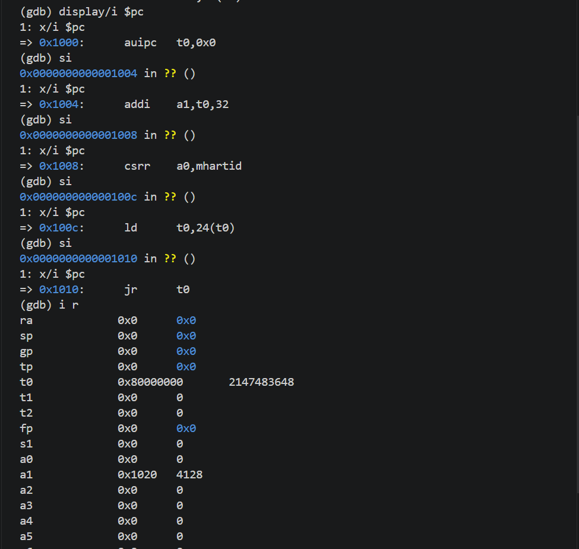

# lab1

# 实验报告

## 实验基本信息

|项目|内容|
|---|---|
|**实验名称**|Lab 1: 比麻雀更小的麻雀（最小可执行内核）|
|**小组成员**|2511098\-陈俊锡、2513599\-胡健飞、2510942\-华星源|
|**完成日期**|2026\-10\-10|

### 小组分工

练习如何分工？

|成员|负责的练习/模块|
|---|---|
|2511098\-陈俊锡|最小内核初始化、输出链路与编译运行|
|2513599\-胡健飞|练习一：程序入口操作|
|2510942\-华星源|练习二：使用 GDB 验证启动流程|

实验报告如何分工？

|成员|负责的实验报告部分|
|---|---|
|2511098\-陈俊锡|实验基本信息；小组分工；实验整体逻辑分析；实验环境；编译运行验证模块；测试与验证；实验总结与收获|
|2513599\-胡健飞|实验目的；练习一|
|2510942\-华星源|练习二|

---

## 一、实验目的

本实验的主要目的是：

1. 理解 RISC\-V 架构下操作系统内核的启动过程。

2. 掌握内核栈的建立方式和汇编跳转到 C 代码的方法。

3. 理解链接脚本的作用，代码段起始地址与物理加载地址的关系，内核链接地址为什么是0x80200000。

4. 理解最小内核的初始化流程与cprintf输出的原理。

5. 掌握使用QEMU运行内核的方法，使用GDB跟踪内核启动的调试方法。

---

## 二、实验环境

你们使用的 AI 工具

|成员|AI 编程工具|底层模型|备注|
|---|---|---|---|
|2511098\-陈俊锡|Codex（VS Code插件）|GPT\-6\.1\-sol|无|
|2513599\-胡健飞|Claude Code（VS Code插件）|DeepSeek\-V4\-Flash|无|
|2510942\-华星源|Claude Code（VS Code插件）|DeepSeek\-V4\-Flash|无|

---

## 三、实验整体逻辑分析

### 2\.1 本章节的逻辑主线

本章围绕“操作系统内核如何启动”展开，目标是在QEMU模拟的RISC\-V计算机上运行一个能够输出启动信息的最小内核，为后续实验提供基础。

整个实验需要解决三个问题：内核代码应该放在什么位置，如何从汇编入口进入C语言函数，内核如何在没有现成输出函数的情况下输出信息。本章依次介绍内存布局与链接脚本、入口汇编与内核栈、C语言初始化函数、OpenSBI的输出接口，最后通过make命令初始化内核并通过GDB调试排查错误。

### 2\.2 功能的逐步实现

1. 首先确定**内核内存布局与入口位置**。通过kernel\.ld设置内核基地址，使内核入口与QEMU的加载地址衔接。只有先确定代码的位置，固件移交控制权后才能执行正确的内核指令。

2. 接着建立**内核栈并进入C语言函数**。在entry\.S中设置内核栈指针，再通过tail kern\_init进入C语言函数。由于C函数的局部变量和函数调用需要使用栈，因此必须在进入C函数之前准备好栈环境。

3. 然后完成**内核初始内存清零与启动行为安排**。`kern_init()`利用edata和end，调用`memset()`将对应的全局变量和静态变量初始为零；随后调用输出接口打印启动信息，最后进入无限循环，使内核不再返回汇编入口。输出启动信可以确认内核已进入初始化阶段；无限循环可以保持内核运行，避免在后继操作没有实现时就返回汇编入口。

4. 再构建**基于OpenSBI的输出功能**。`sbi_console_putchar()`通过`sbi_call()`将数据放入对应的寄存器，通过`cons_putc()`进行计数，执行ecall调用SBI服务进行输出。由于内核不能直接操作系统的标准库，需要利用OpenSBI提供的字符输出接口进行封装，才能显示初始化函数中的启动信息。

5. 最后**编译运行**。通过make命令来执行Makefile中的代码，将源文件编译为ELF文件，再转换为二进制镜像；使用GDB内核入口之间的控制流转移。这样可以将代码分析与实际执行过程相对应，验证最小内核的启动流程是否符合预期。

---

## 四、实验内容与实现

### 功能模块：最小内核初始化、输出链路与编译运行

**负责人：** 2511098\-陈俊锡

#### 模块功能描述

**需要实现的函数：**

```C
int kern_init(void) __attribute__((noreturn));
void *memset(void *s, char c, size_t n);
int cprintf(const char *fmt, ...);
int vcprintf(const char *fmt, va_list ap);
void vprintfmt(void (*putch)(int, void *), void *putdat, const char *fmt, va_list ap);
static void cputch(int c, int *cnt);
void cons_putc(int c);
void sbi_console_putchar(unsigned char ch);
uint64_t sbi_call(uint64_t sbi_type, uint64_t arg0, uint64_t arg1, uint64_t arg2);
```

**功能说明：**

本模块负责分析内核进入内存之后进行初始化的过程，同时通过编译来验证最小内核可以正常启动。具体过程如下：

1\.内核初始化，在`entry.S`开始执行后，它为C语言函数调用分配栈空间，跳转到`kern_init()`函数，调用`memset()`使`.bss`中的变量初始化为零。最后，`kern_init()`调用`cprintf()`输出信息表示内核启动成功。

2\.格式化输出，`cprintf()`调用`vcprintf()`，`vprintfmt()`调用`vprintfmt()`；字符回调函数`cputch()`调用`cons_putc()`来进行计数，`cons_putc()`再调用`sbi_console_putchar()`通过`sbi_call()`将服务编号放入a7，参数放入a0至a2，执行ecall调用SBI服务进行输出，从a0获取返回值。最后`vcprintf()`返回字符数量，`cprintf()`再将其返回调用方。

3\.编译运行，通过make命令来执行Makefile中的代码，进行交叉编译和汇编。首先生成elf文件，再将其转换为bin文件。使用qemu启动加载内核实现内核初始化和输出。

#### 实现迭代过程

本模块的实现经历了1次迭代，过程如下：

---

##### 第一次迭代

**最终结果：**

经过1次迭代，该模块最终：

- ✅ 编译通过，执行make qemu后编译成功，qemu正常启动

- ✅ 所有相关测试通过，终端输出\(THU\.CST\) os is loading \.\.\.

- ✅ 功能符合预期，终端完成输出后内核进入循环，与预期一致

---

### 练习一：**理解内核启动中的程序入口操作**

**负责人：** **2513599\-胡健飞**

**la sp, bootstacktop**

这条指令把启动栈的栈顶地址装进sp。la是伪指令，取符号的地址；在\-mcmodel=medany下它展开成 PC 相对的两条指令。auipc sp,0x3执行时PC是0x80200000，把0x3左移12得到0x80203000；第二条本来是addi sp,sp,0，因为栈顶地址低12位是0，objdump把它显示成了 mv sp,sp。bootstacktop是0x80203000，和预期一致，最终p指向0x80203000。这条指令的目的是给后面要执行的C代码准备好栈。编译器给kern\_init生成的函数是addi sp,sp,\-16和sd ra,8\(sp\)，返回地址需要放到栈上。

取栈顶是因为RISC\-V的栈向低地址方向增长，压栈时sp减小，所以sp指向高地址那一端。栈的大小由memlayout\.h的KSTACKPAGE和mmu\.h的PGSIZE决定。bootstack的地址是0x80201000，bootstacktop的地址是 0x80203000，相差0x2000，8192 字节。

**tail kern\_init**

tail是尾调用伪指令，用来跳转到目标地址，但不保存返回地址。在entry\.o里对应两条指令：

```C
+0x08:  0x00000317    auipc  t1, 0x0
 +0x0c:  0x00030067    jalr   x0, 0(t1)
```

通过readelf \-r可以得知还有R\_RISCV\_CALL和R\_RISCV\_RELAX两个重定位项。目标寄存器是x0而不是ra，说明返回地址不保存在机器级上，而x0是连线的零寄存器，写进去的值会被直接丢掉。在链接出来的kernel中，两条指令合并成一条。

```C
80200008:  a009    j    8020000a <kern_init>
```

链接器用来合并，kern\_init距离kern\_entry 0xa字节，在1MB内，ld的RISC\-V后端默认打开松弛，把auipc加jalr这一对合成一条j。重新链接的时候多加一个\-\-no\-relax

```C
80200008:  00000317    auipc  t1,0x0
 8020000c:  00830067    jr     8(t1)   # 80200010 <kern_init>
```

j变回了auipc和jalr，kern\_init的地址从0x8020000a变为0x80200010，这条指令把控制权交给kern\_init。tail表示kern\_entry是内核的第一条指令，从OpenSBI直接跳转过来，ra中没有值，也就不必要保存，同时kern\_init声明了noreturn，值也就不可能返回，另外tail不使用栈，kern\_init开始执行时sp并不会发生变化。

综上，加电之后PC从复位地址0x1000开始，执行MROM里的复位代码，跳到0x80000000处的OpenSBI；OpenSBI在M模式初始化完毕，把内核镜像加载到0x80200000，再切到S模式。内核的第一条指令就是kern\_entry，它用la把栈建起来，再用tail交给C。在此之后C代码才能正常执行。

---

### 练习二：使用GDB验证启动流程

**负责人：2510942\-华星源** 

**练习内容：** 使用 GDB 跟踪 QEMU 模拟的 RISC\-V 从加电开始，直到执行内核第一条指令（跳转到 0x80200000）的整个过程。

**调试过程：** 使用vs code打开两个终端，其中一个输入make debug，另一个输入make gdb，这时两个终端通过1234端口连接起来，成功连接如图所示。此时复位地址显示为0x1000。执行“x/20i $pc”可以看到当前pc后面20条指令的反汇编代码，其中只有前五条是实际执行的，在0x1018中存储的是0x80000000，即OpenSBI程序的入口地址。


继续执行“b \*kern\_entry”在kern\_entry函数处打断点，然后执行“c”继续运行OpenSBI程序，最后停在断点处0x80200000，如下图所示。


继续执行“c”，运行kern\_entry函数部分，结果如图所示


kern\_entry函数的反汇编代码如图所示，执行到0x8020003a时进入死循环


**两个问题：**

1. RISC\-V 硬件加电后最初执行的几条指令位于什么地址？

成功连接后程序停在0x1000这个地址，最初的五条指令位于0x1000到0x1010。

2. 它们主要完成了哪些功能？

```Plain Text
0x1000:    auipc    t0,0x0        #获取当前指令地址0x1000到临时寄存器t0
0x1004:    addi     a1,t0,32      #设置a1为设备树DTB的地址，传递硬件描述信息
0x1008:    csrr     a0,mhartid    #读取当前CPU核心编号放到a0，作为SBI的第一个参数，即0x1020
0x100c:    ld       t0,24(t0)     #从0x1000+24内存处读取OpenSBI主入口地址，即0x80000000
0x1010:    jr       t0            #跳转进入OpenSBI主程序
```

下图显示执行这几条指令之后寄存器中的值，可以看到t0中是0x80000000，a1中是0x1020




---

## 五、测试与验证

**测试截图：执行make qemu后qemu正常启动，终端输出\(THU\.CST\) os is loading \.\.\. 随后进行无限循环，与预期一致**


---

## 六、实验总结与收获

### 对操作系统的理解

1. 本实验中的重要知识点及其与OS原理的对应关系

操作系统的启动与控制权移交，操作系统启动是指从机器复位开始，经过固件初始化，最终进入内核执行的过程。本实验中，CPU从0x1000处的复位代码开始执行，进入OpenSBI，再由OpenSBI将控制权交给内核。这对应OS原理中的系统引导过程，说明操作系统需要依靠固件进行初始化。二者的区别在于，本实验由QEMU预先加载固件和二进制镜像文件，而计算机的启动要进行启动设备选择和从存储设备读取内核等步骤。

内存初始化，本实验通过链接脚本来生成代码段，并在kern\_init\(\)中清零对应内存。这对应OS原理中环境初始化的过程，用来保证程序能够在正确的位置执行同时变量能够有正确的初值。区别在于，本实验使用预先确定的布局，并没有涉及地址空间和动态内存管理。

内核栈，在本实验中，内核栈由入口汇编通过设置sp建立，用于为C函数保存局部变量提供空间。这对应OS原理中的内核栈和执行上下文。区别在于，本实验只使用启动栈，没有涉及多个进程各自的内核栈，以及进程切换时的现场保存和恢复。

2. OS原理中重要、但本实验尚未涉及的知识点

（1）进程管理。进程的创建、阻塞、退出和切换，以及处理器调度策略。本实验只有一个内核，没有实现多任务运行。

（2）虚拟内存管理。页表、地址转换和缺页处理。本实验进行了内存初始布局与清零，没有进行虚拟内存管理。

（3）中断与异常处理。中断由外部的事件引起，异常由当前的指令引起。本实验通过ecall触发异常来请求OpenSBI服务，但没有完整的内核中断与异常处理机制，不能依靠这些机制完成缺页处理等功能。

3. cprint函数是实现接受不定参数的方法

cprintf()通过形参列表中的“...”接收数量不固定的参数，并使用va_list、va_start、va_arg和va_end完成参数访问。函数首先定义va_list类型的变量ap，再通过va_start(ap, fmt) 初始化访问状态，其中fmt是最后一个固定参数。随后，ap被依次传入vcprintf()和vprintfmt()，由vprintfmt()及其辅助函数根据格式字符串中的格式说明，通过 va_arg依次读取参数，例如遇到%d时读取整数，遇到%s时读取字符串指针。处理结束后，cprintf()调用va_end(ap)结束读取，并返回输出字符数。

### AI 协作开发的经验

本次实验中，AI主要帮助我们梳理启动流程和理解函数调用关系。通过这种协作，我们认识到，提供明确的提示词，有助于获得更符合本实验要求的分析。启动流程那部分概念，比如内核为什么非得链接0x80200000、OpenSBI和内核是怎么交接的，在AI的辅助下会更好理解；看entry\.S、init\.c这些源码的时候，也是先让它解释一遍，再对着反汇编核一遍；处理编译链接报错和QEMU运行异常时也使用过。我们也发现，AI可能使用常见实现代替项目中的具体实现。例如，memset\(\)在本项目中的第二个参数是char，而常见标准库接口使用int。因此，函数调用关系必须与源码逐项核对。报告需要区分源码分析、预期行为和实际验证结果。理解代码能够说明程序预计怎样运行，但不能代替编译输出。只有实际执行并观察到的结果，才能写成已经验证的结论。对于模板中的提示词和迭代过程，我们应根据真实经历填写。已有代码能够正常运行时，不需要为了满足模板形式而进行无关修改。AI可以辅助理解和表达，但最终的判断与实验结论仍应由我们结合源码和实际结果确认。

